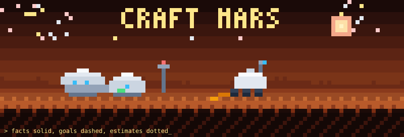
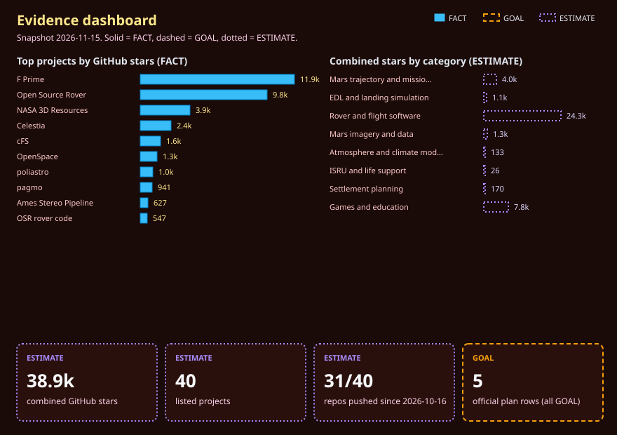

# Awesome Craft Mars 

> A curated list of open-source tools and open data for Mars missions and settlement planning.

Open-source software for getting to Mars, landing, driving rovers, reading imagery and thinking through settlement. Every project has a public repository that was checked on 2026-11-15. Figures on the dashboard are tagged FACT (measured, with a cited source and date), GOAL (a stated plan, not a result) or ESTIMATE (a sum or count computed here). NASA and SpaceX roadmaps in the Plans table are GOAL. This list does not present target dates as facts, does not include unverified cost claims, and the pixel banner is an original scene without company logos or wordmarks.

## Contents

- [Dashboard](#dashboard)
- [Mars trajectory and mission design](#mars-trajectory-and-mission-design)
- [EDL and landing simulation](#edl-and-landing-simulation)
- [Rover and flight software](#rover-and-flight-software)
- [Mars imagery and data](#mars-imagery-and-data)
- [Atmosphere and climate models](#atmosphere-and-climate-models)
- [ISRU and life support](#isru-and-life-support)
- [Settlement planning](#settlement-planning)
- [Games and education](#games-and-education)
- [Plans](#plans)
- [Related lists](#related-lists)
- [Star history](#star-history)

## Dashboard

<table>
<tr>
<td align="center"><h2>40</h2>ESTIMATE listed projects</td>
<td align="center"><h2>8</h2>ESTIMATE software categories</td>
<td align="center"><h2>38.9k</h2>ESTIMATE combined GitHub stars</td>
<td align="center"><h2>7.2k</h2>ESTIMATE combined GitHub forks</td>
<td align="center"><h2>31/40</h2>ESTIMATE repos pushed in the last 30 days</td>
<td align="center"><h2>12</h2>ESTIMATE languages among GitHub repos</td>
</tr>
</table>

### How the figures are tagged

<table>
<tr><th>Tag</th><th>Claim</th></tr>
<tr><td>FACT</td><td>Individual GitHub star, fork and last-push values come from the GitHub API, snapshot 2026-11-15, stored in stats.tsv.</td></tr>
<tr><td>ESTIMATE</td><td>Combined GitHub stars (38.9k, or 38,869) are the arithmetic sum of stargazers_count for the 40 GitHub-hosted entries in this list.</td></tr>
<tr><td>ESTIMATE</td><td>Combined forks (7.2k), unique languages (12) and the 31/40 repos pushed on or after 2026-10-16 are counts computed from that same snapshot.</td></tr>
<tr><td>GOAL</td><td>Every row in the Plans table is a stated architecture or timeline, cited from an official NASA or SpaceX page, not a measured outcome.</td></tr>
</table>

Announced landing windows, city scales and architecture segments are GOAL. This list does not invent unofficial dates or cost figures.

### Leaderboard

Individual star counts below are FACT values from the 2026-11-15 GitHub API snapshot.

<table>
<tr><th>Rank</th><th>Project</th><th align="right">Stars</th><th></th></tr>

<tr><td align="center">🥇</td><td><b>F Prime</b></td><td align="right">11.9k</td><td><code>████████████████████</code></td></tr>
<tr><td align="center">🥈</td><td><b>Open Source Rover</b></td><td align="right">9.8k</td><td><code>████████████████</code></td></tr>
<tr><td align="center">🥉</td><td><b>NASA 3D Resources</b></td><td align="right">3.9k</td><td><code>███████</code></td></tr>
<tr><td align="center">4</td><td><b>Celestia</b></td><td align="right">2.4k</td><td><code>████</code></td></tr>
<tr><td align="center">5</td><td><b>cFS</b></td><td align="right">1.6k</td><td><code>███</code></td></tr>
<tr><td align="center">6</td><td><b>OpenSpace</b></td><td align="right">1.3k</td><td><code>██</code></td></tr>
<tr><td align="center">7</td><td><b>poliastro</b></td><td align="right">1.0k</td><td><code>██</code></td></tr>
<tr><td align="center">8</td><td><b>pagmo</b></td><td align="right">941</td><td><code>██</code></td></tr>
<tr><td align="center">9</td><td><b>Ames Stereo Pipeline</b></td><td align="right">627</td><td><code>█</code></td></tr>
<tr><td align="center">10</td><td><b>OSR rover code</b></td><td align="right">547</td><td><code>█</code></td></tr>
</table>

### Licences

          

Licence badges use the project's SPDX identifier when GitHub detects one, or the text of the licence file when that identifier is missing. "Undeclared" means no licence file was confirmed at the repository HEAD on the snapshot date. The NASA Open Source Agreement 1.3 is not OSI-approved; read it before you use those projects. ISIS3 is dedicated to the public domain under CC0 1.0. Archived and unmaintained projects stay in the star sum and are flagged in their entries.

### Sources

<table>
<tr><th>Source</th><th>What it supports</th></tr>
<tr><td>GitHub API, snapshot 2026-11-15 (Asia/Kuala_Lumpur calendar date), stored in <code>stats.tsv</code></td><td>stargazers_count, forks_count, license, language and pushed_at for 40 repositories.</td></tr>
<tr><td>Project licence files read on 2026-11-15</td><td>ISIS3 CC0-1.0, OpenSpace MIT, Trick and Ames GCM NASA Open Source Agreement 1.3.</td></tr>
<tr><td>NASA Moon to Mars Architecture pages and ADD Rev C, fetched 2026-11-15</td><td>Plans table rows tagged GOAL.</td></tr>
<tr><td>SpaceX Mission: Mars and Starship Talks pages, fetched 2026-11-15</td><td>Plans table rows tagged GOAL. Cost figures on those pages are omitted.</td></tr>
</table>

## Mars trajectory and mission design

Tools for Earth–Mars transfers, ephemerides and trajectory optimisation. Porkchop plots can be produced with poliastro (archived) and with Lambert solvers such as pykep and LambertHub.

- [ANISE](https://github.com/nyx-space/anise) - Rust toolkit for SPICE-style trajectory, orientation and ephemeris work, including Mars tours. 
- [GMAT](https://github.com/nasa/GMAT) - NASA's General Mission Analysis Tool for spacecraft trajectory design and optimisation, including Mars transfers. 
- [LambertHub](https://github.com/jorgepiloto/lamberthub) - Collection of Lambert-problem solvers used to compute interplanetary transfer legs. 
- [Nyx](https://github.com/nyx-space/nyx) - High-fidelity astrodynamics and mission-design toolkit written in Rust. 
- [pagmo](https://github.com/esa/pagmo2) - ESA's platform for massively parallel optimisation, often used for trajectory problems. 
- [poliastro](https://github.com/poliastro/poliastro) - Python astrodynamics library with porkchop-plot helpers. Archived (last push 2023-10-14). 
- [pykep](https://github.com/esa/pykep) - ESA toolkit for interplanetary trajectory design, including Lambert and porkchop-style analyses. 
- [SpiceyPy](https://github.com/AndrewAnnex/SpiceyPy) - Pythonic wrapper for NASA's SPICE toolkit, used with official Mars ephemerides. 
- [Tudat](https://github.com/tudat-team/tudatpy) - TU Delft astrodynamics toolbox, with a Python interface around the C++ core. 

## EDL and landing simulation

Open high-fidelity EDL codes used on flown Mars landers are scarce. The entries below are public research or multi-mission simulators that can model atmospheric flight, entry or landing. JPL's DSENDS is not included because it is not a public source repository.

- [42](https://github.com/ericstoneking/42) - General-purpose spacecraft attitude and orbit simulation, including atmospheric flight cases. No licence file was present at the repository HEAD on 2026-11-15. 
- [Basilisk](https://github.com/AVSLab/basilisk) - Modular astrodynamics and spacecraft simulation framework that can model atmospheric flight and landing scenarios. 
- [EDL-Py](https://github.com/CDNoyes/EDL-Py) - Research-grade entry, descent and landing software in Python. Unmaintained (last push 2023-12-01). 
- [Trick](https://github.com/nasa/trick) - NASA simulation framework used for flight-software testbeds, including landing problems. Licensed under the NASA Open Source Agreement 1.3, which is not OSI-approved. 

## Rover and flight software

Flight frameworks flown or used around Mars, plus public rover stacks. F Prime is the framework flown on Ingenuity; the helicopter's complete flight image is not a separate public repository.

- [cFS](https://github.com/nasa/cFS) - NASA Core Flight System, a reusable flight software framework used across many missions. 
- [F Prime](https://github.com/nasa/fprime) - NASA flight software and embedded systems framework, flown on the Ingenuity Mars helicopter. 
- [Kalman](https://github.com/agh-space-systems-rover/kalman_robot) - ROS 2 software stack for AGH Space Systems' planetary rover. 
- [M2020 URDF models](https://github.com/nasa-jpl/m2020-urdf-models) - Perseverance and Ingenuity URDF models used for operations visualisation. Unmaintained (last push 2023-06-07); no licence file was confirmed at the repository HEAD on 2026-11-15. 
- [Open Source Rover](https://github.com/nasa-jpl/open-source-rover) - JPL build-it-yourself six-wheel rover, modelled on Mars rover mobility, with open hardware instructions. 
- [OSR Android app](https://github.com/nasa-jpl/osr-android-app) - Android controller for the JPL Open Source Rover. Unmaintained (last push 2023-09-24). 
- [OSR rover code](https://github.com/nasa-jpl/osr-rover-code) - Software that runs on the JPL Open Source Rover. 
- [Space ROS](https://github.com/space-ros/space-ros) - Meta operating system for space robotics, based on ROS 2. No licence file was detected by GitHub on 2026-11-15. 
- [Space ROS demos](https://github.com/space-ros/demos) - Example Space ROS applications and robot demonstrations. 

## Mars imagery and data

Tools for PDS products, HiRISE and CTX processing, stereo terrain, and public rover raw images. NASA Mars Trek is a public web map rather than a public application repository, so it is cited here as a data service only: https://trek.nasa.gov/. The official PDS Search API client is released on PyPI; its GitHub repository holds generators rather than the installed library, so it is not listed as a separate entry.

- [ALE](https://github.com/DOI-USGS/ale) - USGS Abstraction Layer for Ephemerides, used to load camera geometry for planetary image processing. GitHub did not detect a standard SPDX licence. 
- [Ames Stereo Pipeline](https://github.com/NeoGeographyToolkit/StereoPipeline) - NASA Ames suite for automated stereogrammetry and digital terrain models from orbital and landed planetary imagery, including Mars. 
- [ISIS3](https://github.com/DOI-USGS/ISIS3) - USGS Integrated Software for Imagers and Spectrometers, the standard toolkit for HiRISE, CTX and other planetary mission imagery. Dedicated to the public domain under CC0 1.0. 
- [Mars Raw Utils](https://github.com/MarsRaw/mars-raw-utils) - Utilities that fetch and best-effort calibrate publicly posted raw images from Curiosity and Perseverance. 
- [MMGIS](https://github.com/NASA-AMMOS/MMGIS) - NASA AMMOS web-based geographic information system for planetary mapping, science planning and operations. 
- [PDS Transform](https://github.com/NASA-PDS/transform) - Official NASA PDS tool that converts PDS3 and PDS4 labels and data into other formats. 
- [PDS Validate](https://github.com/NASA-PDS/validate) - Official NASA PDS validator for PDS4 product labels, data and PDS3 volumes. 
- [PRo3D](https://github.com/pro3d-space/PRo3D) - Interactive 3D viewer for high-resolution reconstructions of planetary surfaces, including Mars rover workspaces. 

## Atmosphere and climate models

Open Mars climate models and analysis tools. The LMD Mars Climate Database is widely used but is distributed under its own access terms rather than as a public application repository, so it is not listed as a software entry.

- [Ames GCM](https://github.com/nasa/AmesGCM) - Current NASA Ames Mars Global Climate Model. Licensed under the NASA Open Source Agreement 1.3, which is not OSI-approved. 
- [AmesCAP](https://github.com/NASA-Planetary-Science/AmesCAP) - Analysis pipeline for NASA Ames Mars GCM output, including helpers that can ingest other Mars model formats. 
- [Legacy Ames GCM](https://github.com/nasa/legacy-mars-global-climate-model) - End-of-life public release of the earlier NASA Ames Mars GCM. Unmaintained (last push 2023-04-12); no licence file was confirmed at the repository HEAD on 2026-11-15. 
- [Planetary Code Collection](https://github.com/nschorgh/Planetary-Code-Collection) - Thermal, ice-evolution and exosphere models for planetary surfaces, including Mars. No licence file was confirmed at the repository HEAD on 2026-11-15. 

## ISRU and life support

Open habitat and ECLSS simulators that can be used in Mars settlement studies. No well-maintained public repository for MOXIE flight or plant software was verified for this list.

- [BioSim](https://github.com/scottbell/biosim) - Integrated advanced life-support simulator, originally developed at NASA Johnson Space Center, with a documented REST interface. 

## Settlement planning

Only verified public repositories are listed. Concept sketches and unofficial city plans without a maintained open-source codebase are omitted.

- [Mars Simulation Project](https://github.com/mars-sim/mars-sim) - Detailed Java simulation of early human settlements on Mars, covering people, resources, vehicles and weather. 

## Games and education

Open-source educational maps, models and simulators that feature Mars. Commercial Mars games are omitted.

- [Celestia](https://github.com/CelestiaProject/Celestia) - Real-time 3D space simulation that includes navigable models of Mars and its satellites. 
- [Mars Geology Atlas](https://github.com/eleanorlutz/mars_geology_atlas_of_space) - Code and instructions for making a geologic map of Mars. Unmaintained (last push 2022-11-28). 
- [NASA 3D Resources](https://github.com/nasa/NASA-3D-Resources) - Collection of NASA 3D models, textures and images, including Mars mission hardware. Unmaintained (last push 2025-06-03); no licence file was confirmed at the repository HEAD on 2026-11-15. 
- [OpenSpace](https://github.com/OpenSpace/OpenSpace) - Interactive data visualisation software for the known universe, used in planetariums and research, including Mars datasets. 

## Plans

Official architecture and timeline statements. Every row is tagged GOAL. A published target is not a result. This table does not include unverified cost figures, and it does not treat unofficial interviews or secondary recaps as primary sources.

<table>
<tr><th>Tag</th><th>Statement</th><th>Official source</th><th>Date</th></tr>
<tr><td>GOAL</td><td>NASA&#x27;s Moon to Mars Architecture is an evolving blueprint for crewed deep-space exploration. It currently comprises four segments: Human Lunar Return, Foundational Exploration, Sustained Lunar Evolution, and Humans to Mars. It is not a flight manifest or a set of fixed landing dates.</td><td><a href="https://www.nasa.gov/moontomarsarchitecture/">NASA Moon to Mars Architecture; Architecture Components</a></td><td>Cited 2026-11-15</td></tr>
<tr><td>GOAL</td><td>Architecture Definition Document ESDMD-001 Revision C records the 2025 Architecture Concept Review, including added Mars use cases and functions. The revision was released on 12 December 2025. Calendar crew-landing dates are not treated as facts in this list.</td><td><a href="https://www.nasa.gov/moontomarsarchitecture-architecturedefinitiondocuments/">NASA ADD Rev C (ESDMD-001) and the Architecture Definition Documents page</a></td><td>Released 2025-12-12</td></tr>
<tr><td>GOAL</td><td>SpaceX states that Starship cargo flights to the Martian surface for research, development and exploratory missions start no earlier than 2028. That is a published target, not a recorded result.</td><td><a href="https://www.spacex.com/mars/">SpaceX Mission: Mars</a></td><td>Page fetched 2026-11-15</td></tr>
<tr><td>GOAL</td><td>SpaceX describes a long-term aim of a self-sufficient city on Mars, with crew and cargo moved during transfer windows that open about every 26 months. This list does not treat population or cargo totals as measured facts, and it does not repeat cost figures.</td><td>SpaceX Mission: Mars</td><td>Page fetched 2026-11-15</td></tr>
<tr><td>GOAL</td><td>On 28 May 2025 SpaceX published a Starship talk titled Mars 2026, in which the company presents plans to make life multiplanetary. Specific unofficial retellings of that talk are not cited here.</td><td><a href="https://www.spacex.com/content/starship-talks/mars-2026">SpaceX Starship Talks: Mars 2026</a></td><td>Talk dated 2025-05-28; page fetched 2026-11-15</td></tr>
</table>

## Related lists

Other lists in the Awesome Craft series:

- [Awesome Craft](https://github.com/EdisonTKPcom/Awesome-Craft) - A curated list of open-source, self-hostable alternatives to popular SaaS tools.
- [Awesome Craft Agents](https://github.com/EdisonTKPcom/Awesome-Craft-Agents) - A curated list of open-source chat apps, coding agents, self-hosted agent bots, workflow automation and image-generation UIs.
- [Awesome Craft AI](https://github.com/EdisonTKPcom/Awesome-Craft-AI) - A curated list of open-source, self-hostable AI runtimes, servers, Hugging Face libraries and related infrastructure.
- [Awesome Craft BSC](https://github.com/EdisonTKPcom/Awesome-Craft-BSC) - A curated list of verified open-source clients, SDKs, dev tools and protocol code for BNB Smart Chain and opBNB.
- [Awesome Craft Creative](https://github.com/EdisonTKPcom/Awesome-Craft-Creative) - A curated list of open-source creative apps, including the storytold Craft App Suite and tools for photo, video, animation, 3D, audio and design.
- [Awesome Craft CUDA](https://github.com/EdisonTKPcom/Awesome-Craft-CUDA) - A curated list of open-source CUDA learning material, kernel libraries, tooling and portability projects.
- [Awesome Craft DeepSeek](https://github.com/EdisonTKPcom/Awesome-Craft-DeepSeek) - A curated list of official DeepSeek repositories and open-source harnesses, serving engines, eval tools and fine-tuning stacks that work with DeepSeek models.
- [Awesome Craft DevOps](https://github.com/EdisonTKPcom/Awesome-Craft-DevOps) - A curated list of open-source, self-hostable alternatives to popular DevOps and hosting SaaS tools.
- [Awesome Craft DNA](https://github.com/EdisonTKPcom/Awesome-Craft-DNA) - A curated list of open-source tools for DNA, genomics and synthetic biology.
- [Awesome Craft Ethereum](https://github.com/EdisonTKPcom/Awesome-Craft-Ethereum) - A curated list of verified open-source Ethereum clients, SDKs, dev frameworks, wallets and security tools.
- [Awesome Craft EV](https://github.com/EdisonTKPcom/Awesome-Craft-EV) - A curated list of open-source software and hardware for electric vehicles and charging.
- [Awesome Craft Hardware](https://github.com/EdisonTKPcom/Awesome-Craft-Hardware) - A curated list of open-source tools for PCB, FPGA, ASIC and chip design.
- [Awesome Craft Hyperliquid](https://github.com/EdisonTKPcom/Awesome-Craft-Hyperliquid) - A curated list of verified open-source SDKs, node tools, analytics and community libraries for the Hyperliquid ecosystem.
- [Awesome Craft Jarvis](https://github.com/EdisonTKPcom/Awesome-Craft-Jarvis) - A curated list of open-source tools to run a personal JARVIS-style AI assistant locally, including dashboards, agent runtimes, voice, MCP connections and memory.
- [Awesome Craft Malaysia](https://github.com/EdisonTKPcom/Awesome-Craft-Malaysia) - A curated list of open-source tools useful to Malaysian SMEs, with verified MyInvois support called out separately.
- [Awesome Craft Neuro](https://github.com/EdisonTKPcom/Awesome-Craft-Neuro) - A curated list of open-source tools for brain-computer interfaces, electrophysiology and neurotechnology.
- [Awesome Craft Robotics](https://github.com/EdisonTKPcom/Awesome-Craft-Robotics) - A curated list of open-source robotics software and hardware, including Microduck, Unitree SDKs, open humanoids, arms, simulation and middleware.
- [Awesome Craft Solana](https://github.com/EdisonTKPcom/Awesome-Craft-Solana) - A curated list of verified open-source Solana clients, SDKs, frameworks, explorers and program libraries.
- [Awesome Craft Space](https://github.com/EdisonTKPcom/Awesome-Craft-Space) - A curated list of open-source tools for spaceflight and rockets, covering orbit simulation, telemetry, launch data and more.
- [Awesome Craft Starlink](https://github.com/EdisonTKPcom/Awesome-Craft-Starlink) - A curated list of open-source tools for Starlink and other LEO satellite internet systems.
- [Awesome Craft Web3](https://github.com/EdisonTKPcom/Awesome-Craft-Web3) - A curated list of open-source DEX protocol code, self-custody software, indexers, frameworks and Blockchain infrastructure.

## Star history

## Contributing

Contributions welcome! Read the [contribution guidelines](contributing.md) first.

If this list helped you, give it a ⭐ so others can find it.

